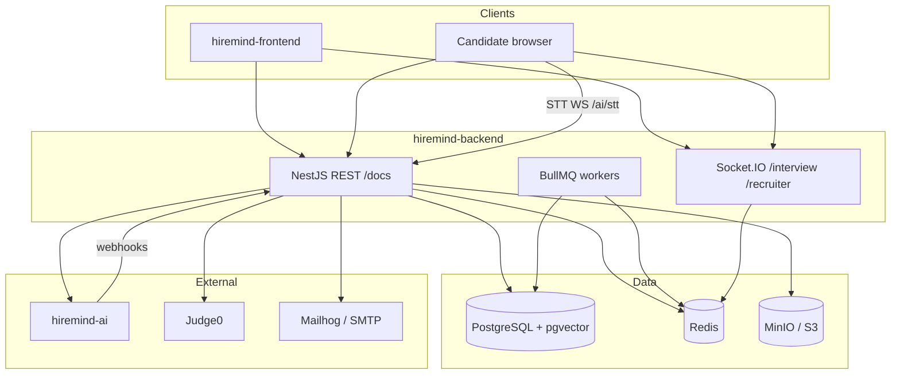

# hiremind-backend

Main API for HireMind: multi-tenant hiring, AI-assisted screening, live interviews, proctoring, and evaluation.

## Architecture



## Stack

- Node 20, NestJS 10, TypeScript strict  
- Prisma 5 + PostgreSQL 16 (pgvector)  
- Redis + BullMQ (parse, interview reminders, retention)  
- Socket.IO + Redis adapter (`/interview`, `/recruiter`)  
- S3/MinIO presigned uploads  
- Pino logging, OpenTelemetry (`OTEL_ENABLED=true`)  
- Swagger at `/docs`  
- Jest + Supertest E2E  

## Quick start

```bash
cp .env.example .env
# Ensure AI_FAKE_MODE=true for local dev without hiremind-ai
docker compose up -d postgres redis mailhog minio minio-init
npm run prisma:deploy
npm run db:seed
npm run start:dev
```

**Full stack with logs** (starts anything down; errors → `logs/*.log`):

```bash
npm run dev:stack    # start all + status + runbook in terminal
npm run dev:status   # UP/DOWN only
npm run dev:runbook  # print what runs on which port (no start)
npm run dev:logs     # tail last lines of each service log
npm run dev:tail     # follow live logs in terminal (Ctrl+C)
npm run dev:stop     # stop processes started by dev:stack
```

| Service | URL |
|---------|-----|
| Marketing site (Next.js) | http://localhost:3002 — `npm run dev:website` |
| API | http://localhost:3001 |
| Swagger | http://localhost:3001/docs |
| Mailhog UI | http://localhost:8025 |

**Seed login:** `admin@acme.hiremind.local` / `ChangeMe123!`  
**Seed job:** Backend Engineer (Node) + 10 parsed sample candidates  

## Modules (all steps)

| Module | Responsibility |
|--------|----------------|
| auth | Staff + candidate JWT, invite, reset, magic link |
| tenants / users | Company, plan, RBAC |
| jobs | CRUD, JD & question bank presign |
| candidates | Bulk upload, parse queue, dedupe, tags |
| shortlist | Auto + manual, history |
| interviews | Create, extend, cancel, reminders, expiry |
| sessions | Start, questions, answers, reconnect, finish |
| coding | Judge0 run/submit (fake mode supported) |
| media | Chunk upload, snapshots, playback URLs |
| proctoring | WS + REST events, strikes, timeline |
| evaluation | Trigger report, overrides |
| reviews | Staff + guest links |
| analytics | Funnel, jobs, recruiters, integrity |
| audit | Access log API |
| privacy | Export/delete candidate, retention job |
| ai-client / webhooks | hiremind-ai integration |
| realtime | Socket.IO gateways |
| stt | Token + `/ai/stt` HTTP/WS proxy |
| conversation | AI interview: LiveKit voice token or text chat, transcript, internal endpoints for the voice agent |

## Socket.IO

- **`/interview`** (candidate): `heartbeat` (5s), `proctoring_batch` (≤2s), `request_next`; server emits `next_question`, `warning`, `terminated`  
- **`/recruiter`** (staff): `watch_interview`, `dashboard_subscribe`  

Auth: pass JWT as `auth.token` or query `token`. Interview room: query `interviewId`.

## AI service

The Python AI service and LiveKit voice interviewer are in [`ai/`](ai/README.md). The React app is in [`frontend/`](frontend/README.md).

## Tests

```bash
npm run test:e2e
```

Requires Postgres + Redis on `.env` URLs. `test/flow.e2e-spec.ts` runs shortlist → interview → session → evaluation with `AI_FAKE_MODE`.

## Docker full stack

```bash
docker compose --profile full up -d
```

Includes optional `hiremind-ai` and `hiremind-frontend` images when published.
